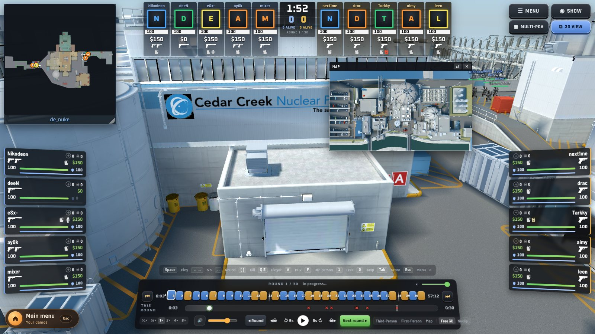
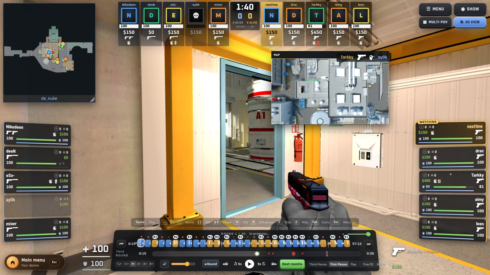
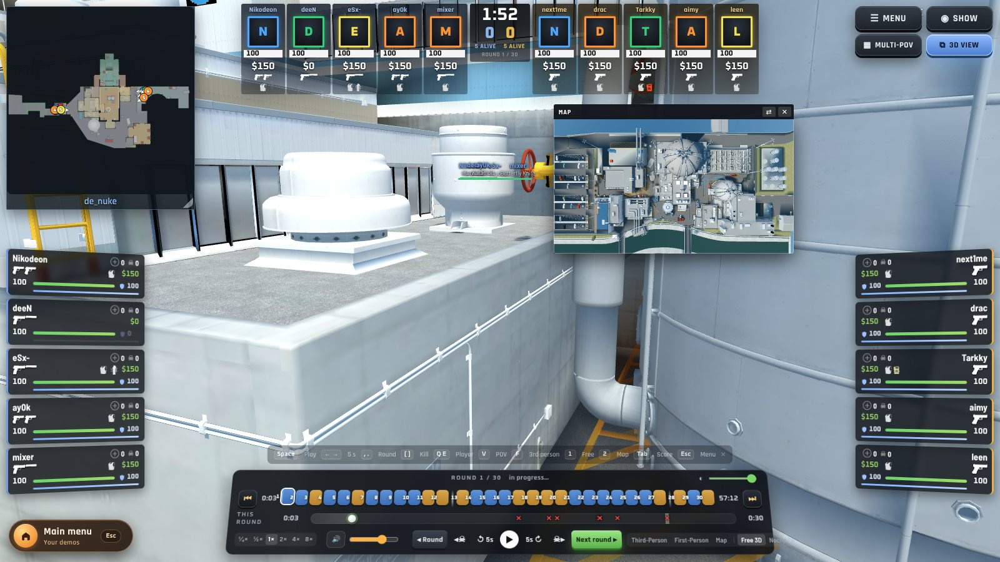
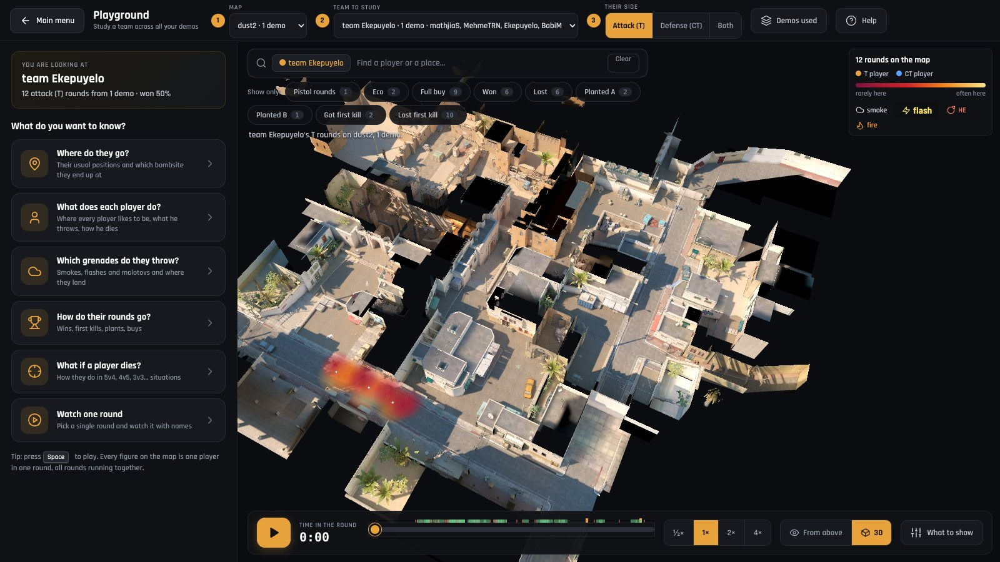
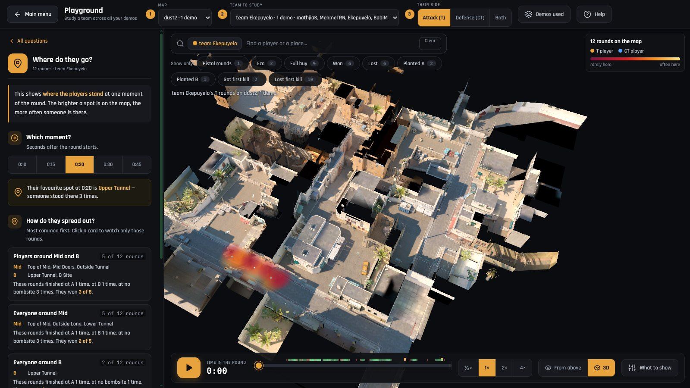
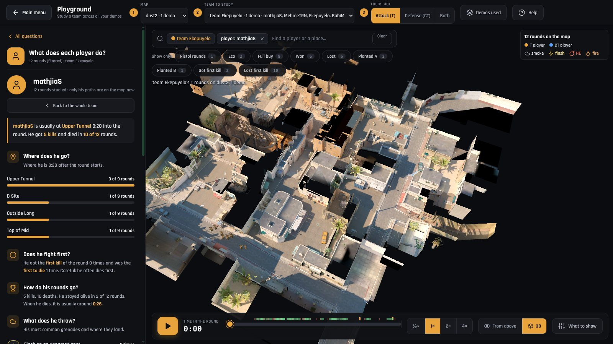

<h1 align="center">CS2 Demo Viewer 3D</h1>

  <b>Watch your Counter-Strike 2 demos in real 3D — and study how a team plays.</b> 
  FACEIT · Valve Matchmaking / Premier · pro (HLTV) demos · Windows · free

  

---

## ⬇ How to start (2 minutes)

1. Go to **[Releases](../../releases/latest)** and download **`CS2-Demo-Viewer-3D-…-win64.zip`** (one file, about 400 MB — app and maps are all inside).
2. **Right-click the zip → Extract All…** Put the folder somewhere fixed, for example `C:\Games\CS2 Demo Viewer 3D`.
3. Open the folder and double-click **`CS2 Demo Viewer 3D.exe`**. Nothing to install.
4. **Drag a demo into the window** (`.dem`, `.dem.zst`, `.gz`, `.bz2` or `.zip`). That's it.

> **"Windows protected your PC"?** The app isn't code-signed, so Windows asks once. Click **More info → Run anyway**.
>
> Keep the `.exe` inside its folder — it needs the files next to it. After the first start you also get a Desktop and Start-menu shortcut.

**Where do I get demos?**
- **FACEIT:** on the match page press *Watch demo* / download, then drag the file in (or paste the download link).
- **Matchmaking / Premier:** in CS2 open *Watch → Your Matches → Download*, then press **Matchmaking demo** in the app's menu.
- **Pro matches:** download the demo from HLTV and drag it in.

---

## 🎬 Demo Viewer — watch one match

 

- **Real maps with the game's own lighting.** Dust2, Mirage and Nuke come included. Any other map is pulled from your own CS2 install the first time you open it (a few minutes, once per map).
- **See through any player's eyes** with the real weapon in hand, or fly freely around the map in 3D / 2D.
- **CS2-style HUD**: scoreboard, radar, kill feed, money, utility, health.
- **Everyone's real skins**, smokes, molotov fire, doors, ragdolls with CS2's own physics.
- **Voice comms** per player (when the demo has them) with marks on the timeline.
- **Multi-POV**: watch several players at once.

## 🧠 Playground — study a team

Pick a **map**, a **team** and their **side** (attack or defense). The Playground takes every round that team played in **all your demos** and plays them **at the same time**, so their habits jump out.

Then just pick a question:

| Question | What you see |
|---|---|
| 📍 **Where do they go?** | Where they usually stand at 0:10, 0:20, 0:30… and which bombsite they pick |
| 🧍 **What does each player do?** | One player's favourite spots, grenades, first duels and every round he played |
| 💨 **Which grenades do they throw?** | Every smoke, flash and molotov and where it lands |
| 🏆 **Are they good?** | How often they win, who gets the first kill, how rounds end |
| ⚔️ **What if someone dies?** | How often they still win 4v5, 3v4, 2v2… |
| ▶️ **Watch one round** | A single round with every player's name |

 

Type a player or a place in the search (press `/`), click any figure on the map to follow that player, and press **Space** to play.

---

## ⌨️ Keys

| Key | Does |
|---|---|
| `Space` | Play / pause |
| `←` `→` | Back / forward 5 s (hold `Shift` for frame by frame) |
| `↑` `↓` | Speed |
| `,` `.` | Previous / next round |
| `1` / `2` | 3D / 2D map |
| `F` / `V` | Follow a player / see through his eyes |
| `Q` / `E` | Previous / next player |
| `Tab` | Scoreboard |
| `O` | Options |
| `F11` | Fullscreen |

---

## ❓ Problems?

- **The app is slow** → *Options → Map quality → Fast* and *Render resolution → Automatic*.
- **A map takes a while the first time** → it's being taken from your CS2 install. It only happens once per map.
- **My CS2 install isn't found** → the app asks you to pick the `Counter-Strike Global Offensive` folder.
- **Where are my files?** → `%APPDATA%\CS2 Demo Viewer 3D` (button *App data* in Options).
- **Something broke** → open an [issue](../../issues) with a screenshot.

---

Not affiliated with Valve. Counter-Strike 2 maps, models, sounds and radar images belong to Valve Corporation. Built with Electron, three.js, demoparser2 and Source 2 Viewer (ValveResourceFormat).
